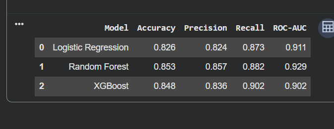
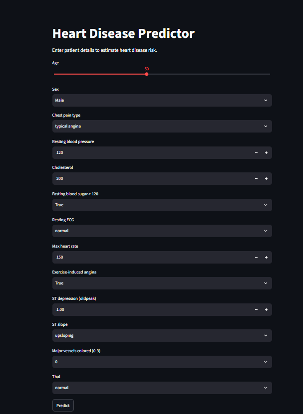
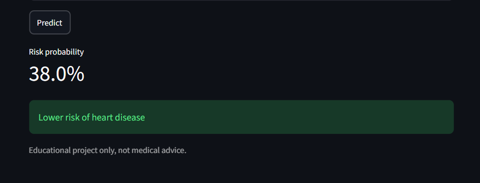

# Heart Disease Prediction

A machine learning project that predicts whether a patient has heart disease, with an interactive web app.

## Dataset
UCI Heart Disease dataset (920 patients, 13 features).

## What I did
- Explored the data and visualized key patterns (older patients showed higher disease rates)
- Cleaned the data: filled missing values, scaled numbers, encoded categories
- Trained and compared three models: Logistic Regression, Random Forest, XGBoost
- Built a Streamlit web app for real-time predictions

## Results

| Model | Accuracy | Precision | Recall | ROC-AUC |
|---|---|---|---|---|
| Logistic Regression | 0.826 | 0.824 | 0.873 | 0.911 |
| Random Forest | 0.853 | 0.857 | 0.882 | 0.929 |
| XGBoost | 0.848 | 0.836 | 0.902 | 0.902 |

Random Forest performed best overall (ROC-AUC 0.93). XGBoost had the best recall.

## The App

## How to run

pip install streamlit pandas joblib scikit-learn==1.6.1 xgboost==3.4.1
python -m streamlit run app.py

## Tools
Python, pandas, scikit-learn, XGBoost, Streamlit

*Educational project only, not medical advice.*
